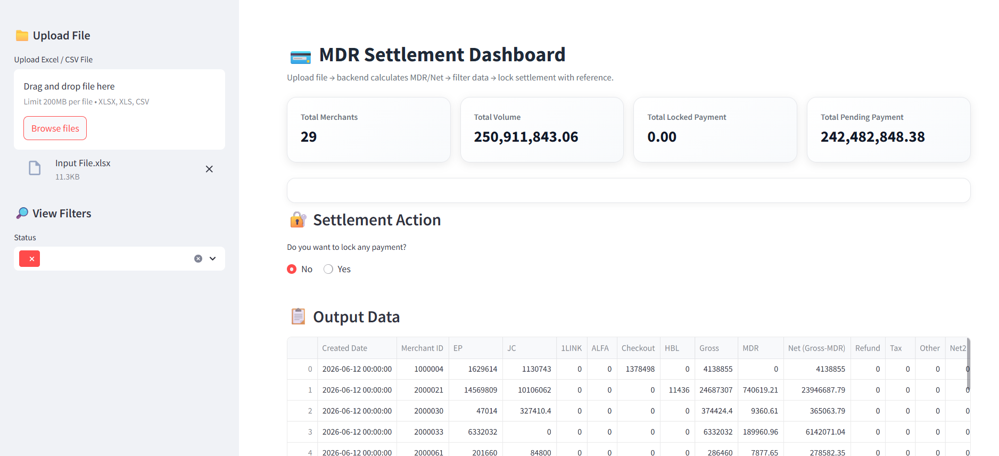
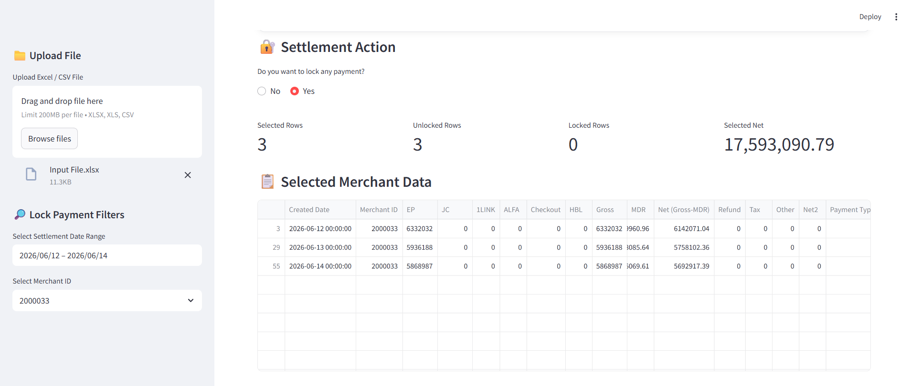
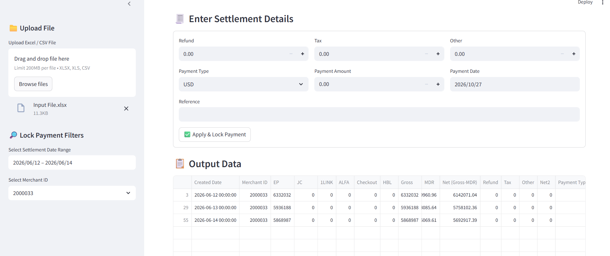
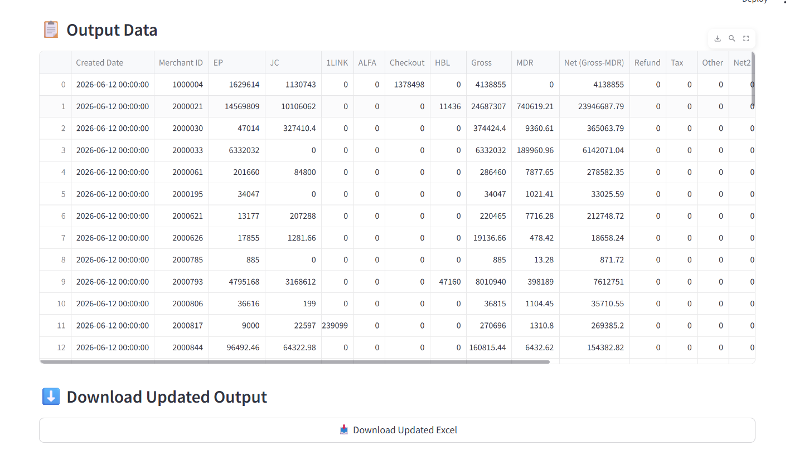

<div align="center">

# 💳 MDR Settlement Dashboard

### Turn a raw merchant transaction file into a locked, audit-ready settlement — in minutes, not hours.

<p>
  
  
  
  
</p>

<p>
  
  
  
</p>



</div>

---

## 📌 The Problem

In a payments company, every merchant has to be paid out on time — after deducting the **MDR (Merchant Discount Rate)** the company charges on each payment channel. Done by hand in Excel, that means:

- Summing transactions across **6 payment channels** per merchant, per day
- Looking up each merchant's **channel-specific MDR rate** and applying it
- Subtracting refunds, tax and other charges
- Tracking which settlements are already paid so nothing is paid twice

It is slow, repetitive, and one wrong cell means a merchant is under- or over-paid.

## ✅ The Solution

A Streamlit app that does the calculation automatically and gives the finance team a **guided settle → lock → download** workflow:

| Before | After |
|---|---|
| Manual formulas per merchant, per channel | Gross, MDR and Net calculated on upload |
| Rate lookup from a separate sheet | 60+ merchant rate profiles applied automatically |
| No clear record of what's been paid | Each settlement is **Locked** with payment type, date and reference |
| Re-running a sheet risks overwriting paid rows | Locked rows are never recalculated |

---

## 🖼️ Screenshots

<table>
  <tr>
    <td width="50%" align="center">
      <b>1️⃣ Filter by Merchant & Date</b><br/><br/>
      
    </td>
    <td width="50%" align="center">
      <b>2️⃣ Enter Settlement & Lock</b><br/><br/>
      
    </td>
  </tr>
  <tr>
    <td colspan="2" align="center">
      <b>3️⃣ Review Output & Download</b><br/><br/>
      
    </td>
  </tr>
</table>

---

## ⚙️ How It Works


### The calculation

```
Gross = EP + JC + 1LINK + ALFA + Checkout + HBL
MDR   = Σ (channel amount × merchant's rate for that channel)
Net   = Gross − MDR
Net2  = Net − (Refund + Tax + Other)
```

MDR is **channel-aware**: the same merchant can pay, for example, 3.5% on wallet transactions and 0% on Checkout — each channel is priced separately.

---

## ✨ Features

- **📁 Multi-format upload** — `.xlsx`, `.xls` and `.csv`
- **🧮 Automatic processing** — Gross, MDR and Net computed the moment a file is uploaded
- **🏦 Channel-level MDR rules** — per-merchant rates across EP, JC, 1LINK, ALFA, Checkout and HBL
- **📊 Live KPIs** — selected rows, unlocked vs. locked rows, and selected Net at a glance
- **🔎 Smart filters** — by date range, merchant and settlement status
- **🔐 Payment locking** — capture payment type, amount, date and reference; locked rows are protected from recalculation
- **⬇️ One-click export** — the full updated settlement file, ready for finance records
- **🔒 No database** — files are processed in memory; nothing is stored on a server

---

## 🏗️ Architecture

The project keeps **business logic and UI strictly separate**:

```
mdr-settlement-dashboard/
├── app.py             # Streamlit UI — upload, filters, KPIs, settlement form, download
├── backend.py         # All calculations — Gross, MDR rules, Net, locking logic
├── requirements.txt   # Dependencies
├── workflow           # Process flow notes
└── asset/             # README screenshots
```

`app.py` never does math — it calls `process_file()` in `backend.py`, which returns a clean DataFrame. That keeps the rules testable and easy to change without touching the interface.

---

## 🚀 Getting Started

```bash
# 1. Clone
git clone https://github.com/sameedtaj/mdr-settlement-dashboard.git
cd mdr-settlement-dashboard

# 2. Install
pip install -r requirements.txt

# 3. Run
python -m streamlit run app.py
```

The app opens at `http://localhost:8501`.

### Input file format

Your file needs these columns (extra settlement columns are added automatically if missing):

| Column | Description |
|---|---|
| `Created Date` | Transaction / settlement date |
| `Merchant ID` | Numeric merchant identifier |
| `EP`, `JC`, `1LINK`, `ALFA`, `Checkout`, `HBL` | Transaction amount per payment channel |

---

## 🛠️ Tech Stack

| Layer | Tools |
|---|---|
| Interface | Streamlit |
| Data processing | Pandas |
| File I/O | openpyxl, xlrd |
| Language | Python 3.10+ |

---

## 🗺️ Roadmap

- [ ] Move merchant MDR rates into an editable config file
- [ ] Settlement history and audit log
- [ ] Charts for channel mix and MDR revenue trends
- [ ] Docker image and one-click cloud deployment

---

<div align="center">

### 👤 Muhammad Sameed

**Data Scientist · AI Engineer · FinTech**

<a href="https://www.linkedin.com/in/muhammad-sameed-4724b81a4">
  
</a>
<a href="https://github.com/sameedtaj">
  
</a>

⭐ If you find this project useful, consider giving it a star!

</div>
